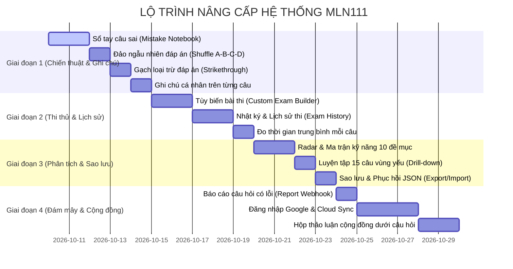

# 📋 KẾ HOẠCH TRIỂN KHAI TÍNH NĂNG MỚI (FEATURE ROADMAP & TECHNICAL PLAN)
**Dự án:** Ứng dụng Ôn thi Triết học Mác – Lênin (MLN111)  
**Phiên bản kế hoạch:** 2.0  
**Tập tin dữ liệu cốt lõi:** `src/data/questions.json` (598 câu chuẩn Giáo trình 2021)  
**Mục tiêu:** Nâng cấp từ một ứng dụng làm trắc nghiệm cơ bản thành nền tảng ôn luyện cá nhân hóa, chẩn đoán điểm yếu, hỗ trợ chiến thuật phòng thi và đồng bộ đa thiết bị.

---

## 📌 MỤC LỤC
1. [Tổng quan & Ma trận phân loại ưu tiên](#1-tổng-quan--ma-trận-phân-loại-ưu-tiên)
2. [Chi tiết Kỹ thuật 4 Nhóm Tính năng](#2-chi-tiết-kỹ-thuật-4-nhóm-tính-năng)
   - [Nhóm 1: Luyện tập Thông minh & Chiến thuật Thi](#nhóm-1-luyện-tập-thông-minh--chiến-thuật-thi)
   - [Nhóm 2: Lưu trữ, Đồng bộ & Đa thiết bị](#nhóm-2-lưu-trữ-đồng-bộ--đa-thiết-bị)
   - [Nhóm 3: Phân tích Năng lực & Chẩn đoán Điểm yếu](#nhóm-3-phân-tích-năng-lực--chẩn-đoán-điểm-yếu)
   - [Nhóm 4: Tương tác, Ghi chú & Báo cáo](#nhóm-4-tương-tác-ghi-chú--báo-cáo)
3. [Kế hoạch Tái cấu trúc Kiến trúc (Refactoring Plan)](#3-kế-hoạch-tái-cấu-trúc-kiến-trúc-refactoring-plan)
4. [Lộ trình Triển khai theo 4 Giai đoạn (Roadmap & Milestones)](#4-lộ-trình-triển-khai-theo-4-giai-đoạn-roadmap--milestones)
5. [Đánh giá Rủi ro & Giải pháp Dự phòng](#5-đánh-giá-rủi-ro--giải-pháp-dự-phòng)

---

## 1. TỔNG QUAN & MA TRẬN PHÂN LOẠI ƯU TIÊN

| STT | Nhóm tính năng | Tính năng chi tiết | Độ ưu tiên | Độ phức tạp | Yêu cầu Backend |
| :--- | :--- | :--- | :---: | :---: | :---: |
| **1** | **Chiến thuật thi** | Chế độ "Sổ tay câu làm sai" (Mistake Notebook) | 🔴 P1 (Khẩn) | Trung bình | Không (LocalStorage) |
| **2** | **Chiến thuật thi** | Đảo ngẫu nhiên thứ tự đáp án (Shuffle A-B-C-D) | 🔴 P1 (Khẩn) | Dễ | Không |
| **3** | **Chiến thuật thi** | Công cụ Gạch loại trừ đáp án (Strikethrough) | 🔴 P1 (Khẩn) | Dễ | Không |
| **4** | **Ghi chú & Note** | Ghi chú mẹo nhớ cá nhân theo từng câu (Personal Notes) | 🔴 P1 (Khẩn) | Dễ | Không |
| **5** | **Chiến thuật thi** | Tùy biến bài thi thử (Custom Exam Builder: 15p/30p/60p) | 🟡 P2 (Cao) | Trung bình | Không |
| **6** | **Lưu trữ & Sync** | Lịch sử các lần thi & Xem lại bài cũ (Score Logs) | 🟡 P2 (Cao) | Trung bình | Không |
| **7** | **Phân tích** | Thống kê thời gian trung bình mỗi câu (Pacing Metrics) | 🟡 P2 (Cao) | Dễ | Không |
| **8** | **Phân tích** | Biểu đồ Radar & Ma trận 10 đề mục (Skill Matrix) | 🟡 P2 (Cao) | Trung bình | Không |
| **9** | **Phân tích** | Nút hành động "Luyện tập 15 câu vùng yếu" (Drill-down) | 🟡 P2 (Cao) | Dễ | Không |
| **10** | **Lưu trữ & Sync** | Sao lưu & Khôi phục dữ liệu cục bộ (Export/Import JSON) | 🟡 P2 (Cao) | Dễ | Không |
| **11** | **Ghi chú & Note** | Báo cáo câu hỏi có lỗi (Report Question Modal) | 🟢 P3 (Trung) | Dễ | Webhook / Google Form |
| **12** | **Lưu trữ & Sync** | Đồng bộ Cloud qua Google Login (Supabase / Firebase) | 🔵 P4 (Mở rộng) | Phức tạp | Có (Supabase/Firebase) |
| **13** | **Ghi chú & Note** | Hộp thảo luận & Mẹo nhớ cộng đồng dưới câu hỏi | 🔵 P4 (Mở rộng) | Phức tạp | Có (Giscus / Supabase) |

---

## 2. CHI TIẾT KỸ THUẬT 4 NHÓM TÍNH NĂNG

```
                          KIẾN TRÚC TÍNH NĂNG TOÀN DIỆN
 ┌─────────────────────────────────────────────────────────────────────────────┐
 │                     MLN111 INTERACTIVE QUIZ PLATFORM                        │
 └──────┬──────────────────────┬───────────────────────┬───────────────────────┘
        │                      │                       │                       │
 ┌──────▼──────┐        ┌──────▼──────┐         ┌──────▼──────┐         ┌──────▼──────┐
 │   NHÓM 1    │        │   NHÓM 2    │         │   NHÓM 3    │         │   NHÓM 4    │
 │ CHIẾN THUẬT │        │  LƯU TRỮ &  │         │ PHÂN TÍCH & │         │ TƯƠNG TÁC & │
 │  LUYỆN TẬP  │        │   SYNC      │         │ CHẨN ĐOÁN   │         │   GHI CHÚ   │
 ├─────────────┤        ├─────────────┤         ├─────────────┤         ├─────────────┤
 │• Sổ câu sai │        │• Lịch sử thi│         │• Radar 10   │         │• Note cá    │
 │• Đảo A-B-C-D│        │  & Rank log │         │  đề mục     │         │  nhân       │
 │• Custom Exam│        │• Export/    │         │• Đo thời    │         │• Báo lỗi câu│
 │• Strikethru │        │  Import JSON│         │  gian/câu   │         │• Thảo luận  │
 │  loại trừ   │        │• Cloud Sync │         │• Drill-down │         │  cộng đồng  │
 └─────────────┘        └─────────────┘         └─────────────┘         └─────────────┘
```

---

### NHÓM 1: Luyện tập Thông minh & Chiến thuật Thi (Study Mechanics)

#### 1. Chế độ "Sổ tay câu từng làm sai" (Mistake Notebook)
* **Mục tiêu:** Giúp sinh viên cô lập toàn bộ các câu hỏi đã trả lời sai trong quá trình học và thi thử để tập trung luyện lại trước giờ thi thật.
* **Cơ chế thu thập:**
  * Bất kỳ câu nào trả lời sai ở chế độ Học (`studyAnswers[id].isCorrect === false`) hoặc trong bài Thi thử sẽ được tự động thêm vào `mistakeBook`.
  * Ghi nhận số lần làm sai (`wrongCount`) và thời điểm làm sai gần nhất.
* **Bộ lọc trên giao diện:**
  * Thêm Pill Button trên thanh công cụ lọc: `[❌ Sổ tay câu sai (X câu)]`.
  * Có thể kết hợp lọc: "Chỉ câu sai thuộc Chương 2" hoặc "Chỉ câu sai thuộc Đề mục 3.1".
* **Cơ chế "Tốt nghiệp / Xóa khỏi sổ tay sai" (Mastery Rule):**
  * Khi luyện tập trong chế độ này, nếu sinh viên trả lời **đúng 2 lần liên tiếp** (hoặc nhấn nút *"Đã thuộc câu này"*), câu hỏi sẽ được gỡ khỏi sổ câu sai.
* **Cấu trúc dữ liệu LocalStorage (`mln_mistake_book`):**
  ```ts
  interface MistakeItem {
    questionId: number;
    wrongCount: number;
    lastWrongAt: string;
    consecutiveCorrect: number;
    mastered: boolean;
  }
  type MistakeBook = Record<number, MistakeItem>;
  ```

---

#### 2. Đảo ngẫu nhiên thứ tự các đáp án (Shuffle Options A-B-C-D)
* **Mục tiêu:** Xóa bỏ thói quen học vẹt "nhớ vị trí A, B, C, D" thay vì đọc hiểu kiến thức.
* **Cơ chế hoạt động:**
  * Toggle trên thanh điều khiển: `[🔀 Đảo đáp án: BẬT/TẮT]`.
  * Lưu cấu hình vào `mln_shuffle_options_enabled` (mặc định: `true` khi thi, `false` khi học tùy chọn).
  * **Thuật toán Shuffle:** Sử dụng Fisher-Yates để đảo vị trí các object options, đồng thời gán lại nhãn hiển thị mới (`displayLetter: 'A' | 'B' | 'C' | 'D'`) nhưng giữ nguyên mã gốc `opt.id`.
  * **Chấm điểm & Phím tắt:**
    * Bấm phím `A`, `B`, `C`, `D` hoặc `1`, `2`, `3`, `4` tương ứng với vị trí hiển thị mới.
    * Khi submit, hệ thống ánh xạ `displayLetter` về `opt.id` gốc để so sánh chính xác tuyệt đối với `correctAnswers`.

---

#### 3. Tùy biến bài thi thử (Custom Exam Builder)
* **Mục tiêu:** Thay vì bị cố định 50 câu / 60 phút, sinh viên có thể tạo đề thi theo nhu cầu ôn tập thực tế.
* **Giao diện Hộp thoại Cấu hình Đề thi (Modal):**
  1. **Chọn thời lượng & số lượng câu hỏi:**
     * *Đề Cấp tốc:* 15 câu / 15 phút.
     * *Đề Tiêu chuẩn:* 30 câu / 30 phút.
     * *Đề Chuẩn thi học phần:* 50 câu / 60 phút.
     * *Tùy chỉnh:* Thanh trượt chọn từ 10 đến 100 câu, thời gian từ 5 đến 90 phút (hoặc không giới hạn thời gian).
  2. **Chọn phạm vi kiến thức:**
     * Checkbox chọn chương: `[x] Chương 1`, `[x] Chương 2`, `[x] Chương 3`.
     * Hoặc chọn nguồn câu hỏi đặc biệt:
       * `[ ] Chỉ bốc từ Sổ tay câu sai` (Đề phục hồi điểm yếu).
       * `[ ] Chỉ bốc từ các câu đã Đánh dấu Bookmark`.
  3. **Tùy chọn bổ sung:**
     * Bật/tắt đồng hồ đếm ngược.
     * Bật/tắt đảo thứ tự đáp án A-B-C-D.

---

#### 4. Công cụ Gạch loại trừ đáp án (Strikethrough / Elimination Tool)
* **Mục tiêu:** Tái hiện chiến thuật loại trừ phương án sai trong phòng thi trắc nghiệm thực tế.
* **Thao tác người dùng:**
  * **Desktop:** Nhấp chuột phải (Right Click) vào phương án HOẶC bấm nút icon gạch chéo `[✕ / —]` nằm cạnh nhãn phương án.
  * **Mobile / Cảm ứng:** Nút toggle nhỏ dạng icon tẩy/gạch bên phải mỗi đáp án.
* **Giao diện & Tương tác:**
  * Phương án bị loại trừ: Văn bản gạch ngang (`text-decoration: line-through`), độ mờ (`opacity: 0.35`), huy hiệu A/B/C/D chuyển xám mờ.
  * Khóa chọn nhầm: Không thể click chọn phương án đã bị gạch trừ khi nhấn nút hủy gạch trừ.
  * Lưu trạng thái tạm thời trong phiên làm việc: `eliminatedMap: { [questionId]: Set<string> }`.

---

### NHÓM 2: Lưu trữ, Đồng bộ & Đa thiết bị (Data Persistence & Sync)

#### 1. Nhật ký & Lịch sử các lần thi thử (Exam History & Score Logs)
* **Mục tiêu:** Lưu trữ toàn bộ kết quả các lần thi thử để sinh viên thấy được sự tiến bộ theo thời gian và có thể xem lại chi tiết từng đề thi cũ.
* **Cấu trúc Dữ liệu Lịch sử (`mln_exam_history`):**
  ```ts
  interface ExamHistoryItem {
    id: string; // e.g. "exam_1730000000000"
    timestamp: string; // ISO String
    title: string; // "Đề Chuẩn 50 câu" / "Đề Cấp tốc 15 câu Chương 1"
    config: {
      totalQuestions: number;
      durationMinutes: number;
      chapters: number[];
    };
    score: number; // e.g. 8.6
    correctCount: number;
    totalQuestions: number;
    timeSpentSeconds: number;
    rank: 'S' | 'A' | 'B' | 'C' | 'D';
    earnedExp: number;
    questionsSnapshot: {
      questionId: number;
      userAnswers: string[];
      isCorrect: boolean;
    }[];
  }
  ```
* **Màn hình "Lịch sử Khảo thí":**
  * Bảng danh sách bài thi: Ngày thi, Thời lượng, Điểm số, Xếp hạng (Rank Badge màu vàng/xanh/đỏ).
  * Biểu đồ đường xu hướng (Progress Line Chart) theo dõi biến thiên điểm thi (Lần 1: 6.5 -> Lần 2: 7.8 -> Lần 3: 8.8).
  * Nút **"Xem lại bài làm"**: Tái hiện toàn bộ bài thi đã làm với các phương án đã chọn, đáp án đúng và trích dẫn giáo trình.

---

#### 2. Chiến lược Sao lưu (Backup) & Đồng bộ Đa thiết bị (Cloud Sync)
* **Chiến lược tiếp cận theo 2 giai đoạn:**

```
                    CHIẾN LƯỢC ĐỒNG BỘ 2 GIAI ĐOẠN
 ┌──────────────────────────────────────┐     ┌──────────────────────────────────────┐
 │ GIAI ĐOẠN 2A: OFFLINE-FIRST BACKUP   │     │ GIAI ĐOẠN 2B: CLOUD REALTIME SYNC    │
 │ (Triển khai ngay - 0 chi phí server) │ ──► │ (Nâng cấp qua Supabase / Firebase)   │
 ├──────────────────────────────────────┤     ├──────────────────────────────────────┤
 │• Nút "Xuất file sao lưu (JSON)"      │     │• Đăng nhập 1-chạm Google OAuth       │
 │• Nút "Khôi phục từ file (JSON)"      │     │• Tự động đồng bộ 2 chiều ngầm        │
 │• Tương thích điện thoại & máy tính   │     │• Dữ liệu gắn liền tài khoản cá nhân  │
 └──────────────────────────────────────┘     └──────────────────────────────────────┘
```

* **Giai đoạn 2A: Sao lưu Cục bộ (Export / Import JSON - Zero Server Cost):**
  * Nút `Xuất dữ liệu học tập (.json)`: Đóng gói toàn bộ `studyAnswers`, `bookmarks`, `mistakeBook`, `notes`, `history`, `exp`, `badges` thành 1 file JSON tải về thiết bị.
  * Nút `Nhập dữ liệu (.json)`: Tải file lên từ máy khác với 2 lựa chọn: *Ghi đè* hoặc *Hợp nhất (Merge)*.
* **Giai đoạn 2B: Đồng bộ Đám mây (Supabase / Firebase):**
  * Nền tảng khuyến nghị: **Supabase** (PostgreSQL + Row Level Security + Google OAuth tích hợp sẵn SDK client-side rất nhẹ cho Vite React).
  * Cơ chế Guest-first: Người dùng không bắt buộc đăng nhập vẫn học bình thường trên LocalStorage. Khi nhấn "Đăng nhập Google", hệ thống đẩy toàn bộ LocalStorage lên Cloud Table `user_profiles` và `user_data`.

---

### NHÓM 3: Phân tích Năng lực & Chẩn đoán Điểm yếu (Analytics & Diagnostics)

#### 1. Ma trận Kỹ năng & Biểu đồ Radar theo 10 Đề mục (Skill Matrix)
* **Mục tiêu:** Chẩn đoán chính xác sinh viên đang mạnh ở phần nào, hổng kiến thức ở phần nào trong số 10 đề mục cốt lõi của môn học.
* **Danh sách 10 Đề mục chuẩn hóa từ 598 câu:**
  * **Chương 1 (Khái luận):**
    * `1.1`: Triết học & Vấn đề cơ bản của triết học (Trang 11-47)
    * `1.2`: Triết học Mác – Lênin và vai trò (Trang 47-116)
  * **Chương 2 (Chủ nghĩa duy vật biện chứng):**
    * `2.1`: Vật chất và ý thức (Trang 117-182)
    * `2.2`: Phép biện chứng duy vật (Trang 182-257)
    * `2.3`: Lý luận nhận thức duy vật biện chứng (Trang 257-283)
  * **Chương 3 (Chủ nghĩa duy vật lịch sử):**
    * `3.1`: Học thuyết hình thái kinh tế - xã hội (Trang 284-329)
    * `3.2`: Giai cấp và dân tộc (Trang 329-384)
    * `3.3`: Nhà nước và cách mạng xã hội (Trang 384-419)
    * `3.4`: Ý thức xã hội (Trang 419-447)
    * `3.5`: Triết học về con người (Trang 447-489)

* **Giao diện Trực quan:**
  * Tab mới trên thanh điều hướng: `📊 Báo cáo Năng lực (Analytics)`.
  * **Biểu đồ Radar / Heatmap thanh tỉ lệ:** Thể hiện % chính xác của 10 đề mục.
    * 🟢 Xanh ($\ge 80\%$): Kiến thức vững chắc.
    * 🟡 Vàng ($60\% - 79\%$): Đạt yêu cầu, cần cải thiện tốc độ.
    * 🔴 Đỏ ($< 60\%$): Vùng kiến thức báo động.
  * **Nút hành động một chạm (Actionable Button):**
    * Dưới mỗi đề mục yếu (ví dụ: *Đề mục 3.3 - 42%*), hiển thị nút:  
      👉 `[⚡ Luyện tập ngay 15 câu thuộc Đề mục 3.3]`.
    * Hệ thống tự động lọc các câu làm sai / chưa làm của đề mục đó và chuyển sang giao diện học tập.

---

#### 2. Thống kê Thời gian Trung bình Mỗi câu (Pacing Analytics)
* **Mục tiêu:** Rèn luyện phản xạ căn thời gian thi trắc nghiệm (chuẩn 60 phút / 50 câu = 72 giây/câu; lý tưởng là $\le 45$ giây/câu để dành 15 phút rà soát).
* **Cơ chế thu thập:**
  * Timer đếm thời gian hoạt động thực tế (`activeTimeSeconds`) của sinh viên trên mỗi câu hỏi (tạm dừng khi rời tab / blur window).
* **Các chỉ số báo cáo:**
  * *Thời gian trung bình / câu*: Ví dụ `38s / câu` (Đạt chuẩn) vs `75s / câu` (Chậm).
  * *Cảnh báo câu phân vân*: Đánh dấu những câu tốn $> 60$ giây suy nghĩ để sinh viên xem lại lý do bị nghẽn (do từ ngữ bẫy hay lý luận dài).

---

### NHÓM 4: Tương tác, Ghi chú & Báo cáo (Notes & Explanations)

#### 1. Ghi chú Cá nhân trên từng câu hỏi (Personal Notes)
* **Mục tiêu:** Cho phép người học tự lưu lại mẹo nhớ của riêng mình (ví dụ: *"Cứ thấy cụm từ 'quyết định' là chọn Cơ sở hạ tầng", "Quy luật Lượng - Chất: Tích lũy về lượng dẫn đến sự biến đổi về chất"*).
* **Giao diện:**
  * Hộp ghi chú dạng Accordion hoặc thẻ con nằm ngay dưới câu hỏi:  
    `📝 Mẹo nhớ của tôi (Nhấn để chỉnh sửa)`.
  * Tính năng: Tự động lưu khi rời chuột (auto-save), phím tắt `Ctrl + Enter` để lưu nhanh, nút xóa note.
  * Chỉ báo trên ma trận câu hỏi: Các câu có ghi chú cá nhân sẽ hiển thị icon bút chì `✏️` trên Sidebar Navigator để sinh viên dễ dàng tìm lại.
* **Lưu trữ:** `mln_user_notes: Record<number, string>` (trong LocalStorage & đồng bộ Cloud).

---

#### 2. Báo cáo Câu hỏi có vấn đề (Report Question)
* **Mục tiêu:** Giúp cộng đồng sinh viên gửi phản hồi nếu phát hiện câu hỏi có lỗi chính tả, sai mã trang giáo trình hoặc băn khoăn về đáp án.
* **Giao diện Modal Báo cáo:**
  * Nút bấm: `[Báo lỗi câu này ⚠️]` đặt cạnh tiêu đề câu hỏi.
  * Form gồm:
    * Loại lỗi: *Lỗi chính tả / Nghi ngờ đáp án sai / Sai trích dẫn trang sách / Khác*.
    * Mô tả chi tiết: Textbox nhập ý kiến.
  * **Giải pháp kết nối:**
    * Sử dụng Webhook đẩy thông tin trực tiếp về Google Sheets (thông qua Google Apps Script), Discord/Telegram Webhook, hoặc Supabase Table `question_reports`.
    * Phản hồi người dùng: Toast cảm ơn thông báo đã ghi nhận thành công.

---

#### 3. Hộp Thảo luận & Mẹo nhớ Cộng đồng (Discussion Section)
* **Mục tiêu:** Nơi sinh viên trao đổi kinh nghiệm, giải thích mẹo nhớ cho nhau.
* **Phương án triển khai tối ưu:**
  * **Phương án A (No-Backend / Giscus):** Nhúng hệ thống comment dựa trên GitHub Discussions (Giscus), hoàn toàn miễn phí, lưu trữ lâu dài, hỗ trợ Markdown và phản ứng emoji 👍❤️.
  * **Phương án B (Supabase Realtime Comments):** Tạo bảng `question_comments` cho phép đăng bình luận, upvote các mẹo nhớ hữu ích nhất lên top 1.

---

## 3. KẾ HOẠCH TÁI CẤU TRÚC KIẾN TRÚC (REFACTORING PLAN)

File [`App.jsx`](file:///d:/MLN/quiz-app/src/App.jsx) hiện tại đang có quy mô ~1.885 dòng code tập trung toàn bộ logic. Để bổ sung các tính năng trên mà không làm vỡ code hoặc phát sinh lỗi, cần module hóa theo cấu trúc sau:

```
src/
├── components/
│   ├── common/
│   │   ├── HeaderHUD.jsx           # Thanh Header, Level, EXP, Streak, Theme
│   │   ├── ToastNotification.jsx   # Thông báo thăng cấp / mở huy hiệu
│   │   └── Modals/
│   │       ├── BadgesModal.jsx     # Bảng huy hiệu
│   │       ├── ShortcutsModal.jsx  # Bảng phím tắt
│   │       └── ReportModal.jsx     # Báo cáo câu hỏi lỗi [MỚI]
│   ├── study/
│   │   ├── StudyFilterBar.jsx      # Bộ lọc Chương, Đề mục, Bookmark, Câu sai
│   │   ├── QuestionCard.jsx        # Thẻ câu hỏi, gạch trừ đáp án, ghi chú mẹo
│   │   ├── PersonalNotesBox.jsx    # Hộp ghi chú mẹo nhớ cá nhân [MỚI]
│   │   └── GemNavigator.jsx        # Ma trận 598 câu hỏi
│   ├── exam/
│   │   ├── ExamConfigModal.jsx     # Tùy biến đề thi 15p/30p/60p [MỚI]
│   │   ├── ExamActiveView.jsx      # Giao diện làm bài thi & đếm giờ
│   │   ├── ExamResultView.jsx      # Kết quả xếp hạng Rank S/A/B/C/D
│   │   └── ExamReviewView.jsx      # Xem lại bài thi chi tiết
│   └── analytics/
│       ├── SkillMatrixRadar.jsx    # Biểu đồ năng lực 10 đề mục [MỚI]
│       ├── ExamHistoryList.jsx     # Bảng lịch sử các lần thi thử [MỚI]
│       └── PacingAnalytics.jsx     # Đo thời gian làm bài trung bình [MỚI]
├── hooks/
│   ├── useGamification.js          # Logic EXP, Level, Badges, Streaks
│   ├── useStudySession.js          # Logic làm bài học tập, lọc, bookmarks
│   ├── useMistakeNotebook.js       # Quản lý Sổ tay câu sai [MỚI]
│   ├── useExamEngine.js            # Engine thi thử, bấm giờ, chấm điểm
│   └── usePacingTimer.js           # Đo thời gian mỗi câu [MỚI]
├── services/
│   ├── storageService.js           # Quản lý LocalStorage & Export/Import JSON [MỚI]
│   └── reportService.js            # Webhook gửi báo cáo câu hỏi [MỚI]
├── utils/
│   ├── shuffle.js                  # Thuật toán đảo đáp án A-B-C-D [MỚI]
│   └── sound.js                    # Quản lý hiệu ứng âm thanh Audio API
└── App.jsx                         # Main Router & Layout Switcher (~200 dòng)
```

---

## 4. LỘ TRÌNH TRIỂN KHAI THEO 4 GIAI ĐOẠN (ROADMAP & MILESTONES)



### 🔹 GIAI ĐOẠN 1: Chiến thuật Phòng thi & Ghi chú (Hoàn thiện ngay - Frontend Only)
* [ ] **1.1.** Tích hợp `useMistakeNotebook`: Ghi nhận tự động câu sai, bổ sung nút lọc `Sổ tay câu sai` trên Header.
* [ ] **1.2.** Bổ sung Toggle `Đảo đáp án (Shuffle)` với thuật toán ánh xạ key an toàn.
* [ ] **1.3.** Tích hợp công cụ `Gạch loại trừ đáp án` (Click phải / nút icon gạch chéo).
* [ ] **1.4.** Tích hợp hộp `Ghi chú mẹo nhớ cá nhân` dưới câu hỏi, lưu trữ `mln_user_notes`.

### 🔹 GIAI ĐOẠN 2: Nâng cấp Thi thử & Lịch sử Điểm số
* [ ] **2.1.** Xây dựng Modal `Tùy biến bài thi` (Chọn 15/30/50 câu, chọn phạm vi Chương 1, 2, 3 hoặc chỉ bốc câu sai).
* [ ] **2.2.** Xây dựng Module `Lịch sử Khảo thí` (Lưu 50 bài thi gần nhất, biểu đồ điểm số, tính năng xem lại bài cũ).
* [ ] **2.3.** Tích hợp bộ đếm `Pacing Timer` đo thời gian trung bình từng câu và cảnh báo câu quá 60 giây.

### 🔹 GIAI ĐOẠN 3: Chẩn đoán Điểm yếu & Sao lưu Dữ liệu
* [ ] **3.1.** Xây dựng Màn hình `Báo cáo Năng lực & Radar Ma trận 10 Đề mục`.
* [ ] **3.2.** Tích hợp nút hành động nhanh: *"⚡ Luyện tập 15 câu vùng kiến thức yếu này"*.
* [ ] **3.3.** Thêm tính năng `Export / Import JSON Backup` trong phần Cài đặt để chuyển đổi dữ liệu an toàn giữa các thiết bị.

### 🔹 GIAI ĐOẠN 4: Đám mây & Tương tác Cộng đồng
* [ ] **4.1.** Xây dựng Modal `Báo cáo câu hỏi có vấn đề` kèm Webhook gửi dữ liệu về Google Sheets/Telegram.
* [ ] **4.2.** Kết nối **Supabase** (Google Login 1 chạm, tự động đồng bộ LocalStorage lên Cloud).
* [ ] **4.3.** Tích hợp `Hộp thảo luận & Mẹo nhớ cộng đồng` dưới từng câu hỏi.

---

## 5. ĐÁNH GIÁ RỦI RO & GIẢI PHÁP DỰ PHÒNG

| Rủi ro tiềm ẩn | Mức độ | Biện pháp giải quyết |
| :--- | :---: | :--- |
| **Tráo đáp án làm lệch phần giải thích** | Cao | Các trích dẫn giải thích thường có dạng: *"Đáp án đúng là: C (Quan hệ sản xuất)"*. **Giải pháp:** Trong thuật toán shuffle, text giải thích sẽ tự động thay thế ký tự chữ cái bằng nội dung chuẩn xác của phương án đúng để người đọc không bị mâu thuẫn. |
| **Tràn bộ nhớ LocalStorage (Giới hạn 5MB)** | Trung bình | Dữ liệu 598 câu chỉ lưu ID và đáp án chọn (ước tính < 300KB cho 100 lần thi). Tự động dọn dẹp các bài thi cũ hơn 60 ngày nếu vượt quá 3MB. |
| **Xung đột phím tắt bàn phím** | Trung bình | Khi người dùng đang nhập nội dung trong ô Ghi chú cá nhân (`textarea`), hệ thống sẽ ngắt (disable) toàn bộ phím tắt điều hướng `A-D`, `Space`, `J-K` để tránh gõ phím bị nhảy câu. |
| **Mất dữ liệu khi người dùng đổi thiết bị** | Cao | Triển khai ngay tính năng **Xuất/Nhập file JSON** ở Giai đoạn 2 trước khi bước vào xây dựng Cloud Authentication phức tạp ở Giai đoạn 4. |

---

*Tập tin này được lưu tại:* `FEATURE_PLAN.md` (Thư mục gốc dự án)
